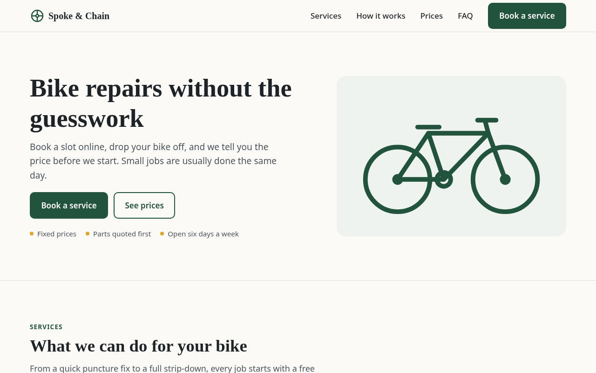

# Spoke & Chain landing page (HTML + SASS)

A responsive landing page for a made-up bike repair shop, built with semantic HTML and SASS. No CSS framework: the layout, components and responsive behaviour are all written by hand.

**Live demo:** https://alexg0dev.github.io/sass-landing-page/



Spoke & Chain is not a real business. The address and phone number are placeholders (the number is from Ofcom's range reserved for drama and fiction).

## What the page includes

- Sticky header with a mobile menu (button with `aria-expanded`, closes on Escape or after picking a link)
- Hero section with a simple inline SVG drawing
- Services grid, a three-step "how it works" list and three pricing cards
- FAQ built with `<details>` and `<summary>`, so it works without JavaScript
- Opening hours in a real table and a booking form with labels and validation (demo only, it does not send anything)
- Mobile-first layout using CSS Grid and Flexbox, tested from 320px phones up to wide desktops

## SASS structure

The styles follow a simple 7-1 style split and BEM naming (`block__element--modifier`).

```
scss/
  abstracts/   variables, a space() function and mixins (breakpoints, focus ring, reduced motion)
  base/        reset and typography
  layout/      container and sections, header and nav, footer
  components/  button, card, faq, form
  sections/    hero, steps, pricing, visit
  main.scss    entry point that pulls everything in with @use
```

A few examples of what is used:

- `@use` and `@forward` modules instead of the old `@import`
- Maps for spacing and breakpoints, read with `map.get` and checked with `@error` if a name is wrong
- A `from($breakpoint)` mixin for mobile-first media queries
- `rgba()` with SASS colour variables for the translucent header

## Accessibility

- Landmarks (`header`, `nav`, `main`, `footer`) and one `h1` with no skipped heading levels
- Skip link, visible focus styles and enough colour contrast for text and buttons
- Every form field has a `<label>`, and form messages are announced with `role="status"`
- Decorative SVGs are hidden from screen readers, and the hero drawing has a text label
- Smooth scrolling is turned off for people who prefer reduced motion
- Without JavaScript the menu is always visible and the FAQ still opens

## Tech

- HTML5
- SASS (Dart Sass), compiled to one compressed CSS file
- A little plain JavaScript for the menu and the demo form
- Node's built-in test runner and jsdom for the checks below
- Hosted on GitHub Pages

## Run it locally

You need Node.js 18 or newer.

```bash
git clone https://github.com/alexg0dev/sass-landing-page.git
cd sass-landing-page
npm install
npm run dev
```

`npm run dev` compiles the SASS to `css/main.css` and serves the folder. Run `npm run watch` in another terminal to recompile when you change a `.scss` file.

To build the site into `dist/` with compressed CSS:

```bash
npm run build
```

## Tests

```bash
npm test
```

The tests check that the SASS compiles, and that the HTML keeps some basics: a language, title, description and canonical link, exactly one `h1` with no skipped heading levels, a label for every form field, a real target for every in-page link, and SVGs that are either hidden or labelled.

## Licence

MIT. See [LICENSE](LICENSE).
